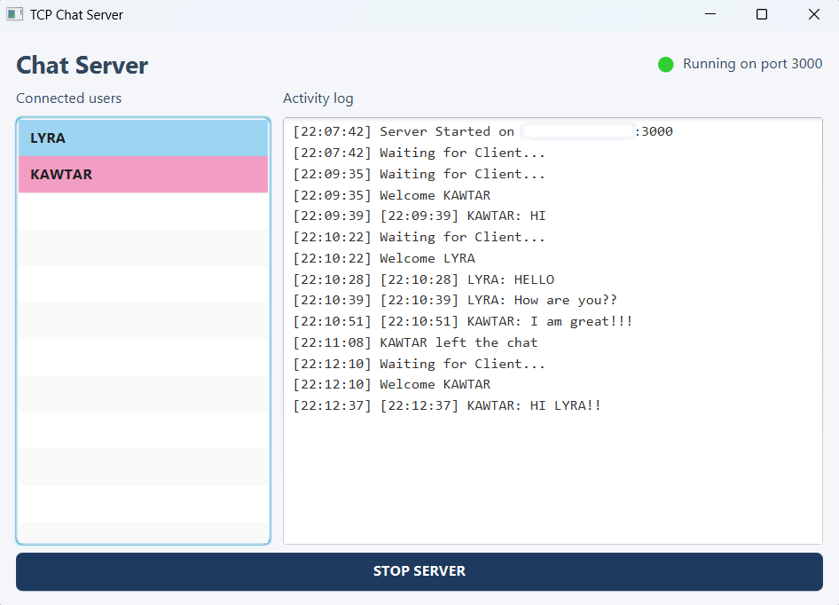
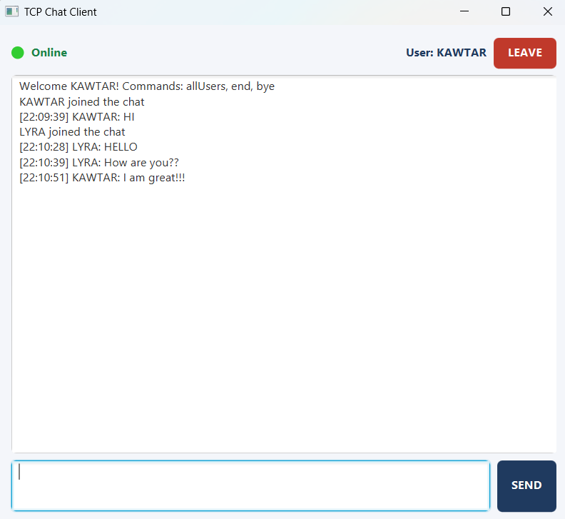
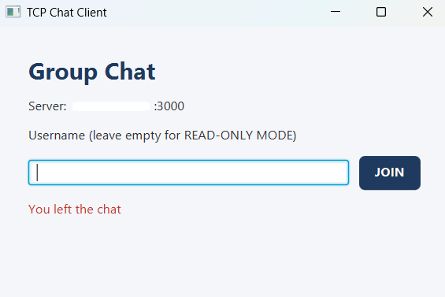
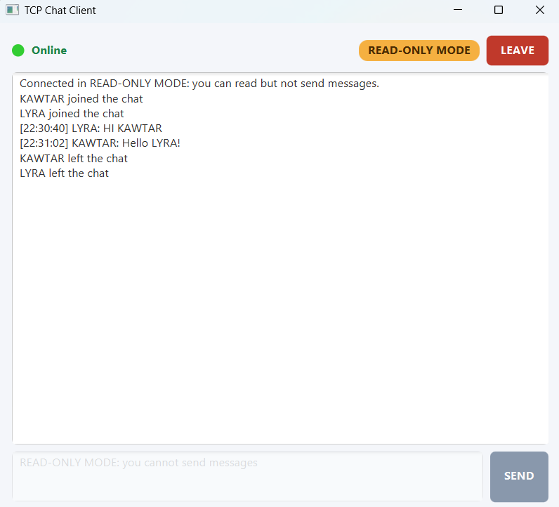
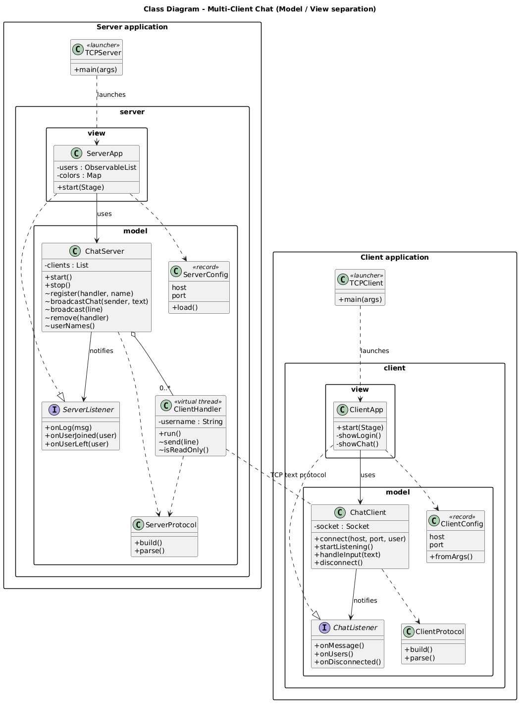
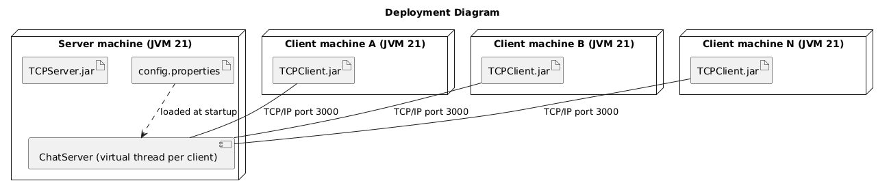
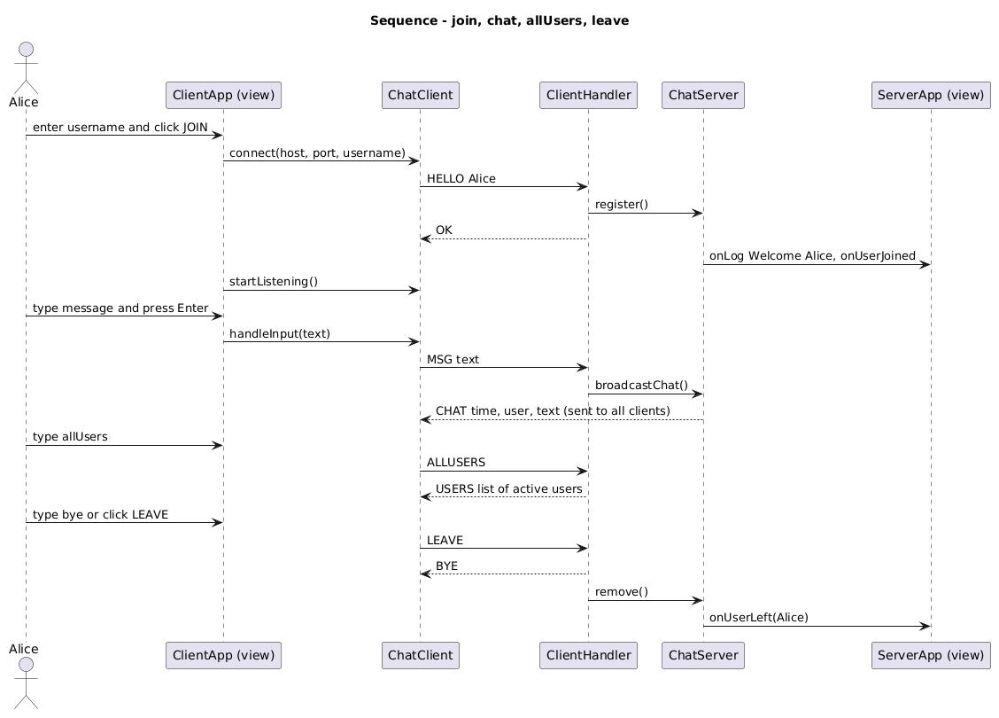
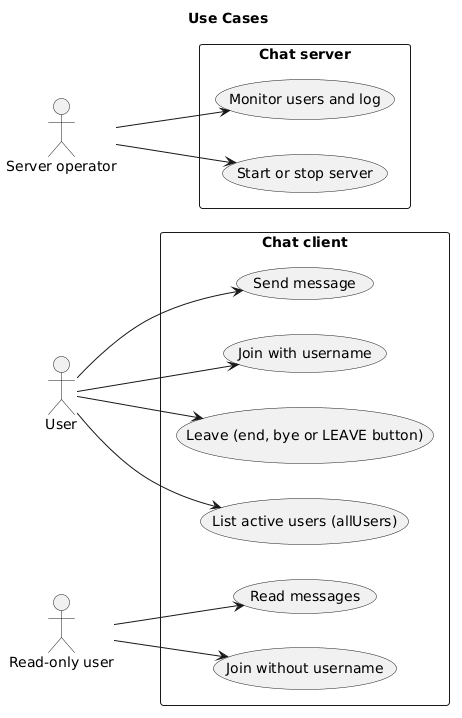

# Multi-Client Chat Application

A real-time group chat application built with **Java 21, TCP Sockets, Virtual Threads, and JavaFX**.

The application follows a client-server architecture: multiple clients connect to a central server, exchange messages, and view the list of active users. The server handles connections and distributes messages to the connected clients.

**Mini Project 1 — Advanced Distributed Programming Paradigms**

| | |
|---|---|
| **Author** | KAWTAR ALMAI |
| **Course** | Advanced Distributed Programming Paradigms |
| **Instructor** | El Habib Nfaoui |
| **University** | Al Akhawayn University in Ifrane |


## Screenshots

The following screenshots illustrate the main interfaces of the application.

| Server Interface | Client Chat Interface |
|---|---|
|  |  |
| Server monitoring and connected users | Real-time group conversation |

| Login Screen | Read-Only Mode |
|---|---|
|  |  |
| Username entry | Reading messages without sending |

## Demo

[Watch the 3-minute project demonstration](docs/demo/video.mp4)

The demonstration covers the application architecture, server startup, client connections, real-time messaging, active user monitoring, and read-only mode.

## Blog Post

I wrote an article about the development process, architecture, and technical challenges
of this project.

**[Building a Multi-Client Chat Application with Java Sockets and JavaFX](https://medium.com/@almai.kawtar/exploring-java-sockets-through-a-multi-client-chat-application-e300d610864a)**

The article explores:
- Client-server architecture using TCP.
- Concurrent client handling with Java virtual threads.
- Designing a simple text-based communication protocol.
- Separating networking logic from the JavaFX interface.
- Lessons learned during development.

## Features

### Client Application

- **Username-based identity:** Enter a username to participate in the chat.
- **Read-only mode:** Connect without a username to read messages without sending them.
- **Real-time messaging:** Send messages using the `SEND` button or the Enter key.
- **Active user inquiry:** Use `allUsers` to retrieve the list of currently connected users.
- **Disconnection:** Leave the chat using the `LEAVE` button or the `end` and `bye` commands.
- **Connection status:** Display an `Online` label and a visual status indicator.

### Server Application

- **Concurrent connections:** Accept multiple clients simultaneously.
- **Message distribution:** Receive messages, format them with the sender's username and timestamp, and distribute them to connected clients.
- **User monitoring:** Display active usernames in a live JavaFX `ListView`.
- **Visual distinction:** Assign random background colors to users in the server interface.
- **Activity logging:** Display server events such as startup, client connections, user departures, and incoming messages.
- **Runtime configuration:** Load the server IP address and port from a configuration file.


## Architecture

The application follows a **Client-Server architecture** with a clear separation between the Model and the View.

<pre>
                 ┌──────────────────────┐
                 │      TCP Server      │
                 │                      │
                 │  ChatServer          │
                 │  ClientHandler       │
                 │  Protocol            │
                 │  ServerApp (JavaFX)  │
                 └──────────┬───────────┘
                            │
                      TCP Connection
                            │
              ┌─────────────┴─────────────┐
              │                           │
     ┌────────▼────────┐        ┌─────────▼───────┐
     │   TCP Client 1  │        │   TCP Client 2  │
     │                 │        │                 │
     │  ChatClient     │        │  ChatClient     │
     │  ClientApp      │        │  ClientApp      │
     └─────────────────┘        └─────────────────┘
</pre>

### Model-View Separation

The application separates networking and business logic from the graphical interface.

| Component | Responsibility |
|---|---|
| **Model** | Handles sockets, communication, commands, and application logic. |
| **View** | Displays the JavaFX interface and handles user interactions. |
| **Listener Interfaces** | Allow the Model to notify the View without depending directly on JavaFX. |
| **Launcher** | Starts the server or client application. |

The server uses **one virtual thread per client connection**, allowing multiple clients to communicate concurrently.

The Model does not depend on JavaFX. This means that changes to the graphical interface do not require changes to the networking logic.

### Project Structure

```text
chat-project/
│
├── TCPServer/
│   ├── pom.xml
│   └── src/main/java/
│       ├── TCPServer.java
│       └── com/chat/server/
│           ├── model/
│           │   ├── ChatServer.java
│           │   ├── ClientHandler.java
│           │   ├── ServerListener.java
│           │   ├── ServerConfig.java
│           │   └── Protocol.java
│           │
│           └── view/
│               └── ServerApp.java
│
├── TCPClient/
│   ├── pom.xml
│   └── src/main/java/
│       ├── TCPClient.java
│       └── com/chat/client/
│           ├── model/
│           │   ├── ChatClient.java
│           │   ├── ChatListener.java
│           │   ├── ClientConfig.java
│           │   └── Protocol.java
│           │
│           └── view/
│               └── ClientApp.java
│
└── docs/
    ├── screenshots/
    │   ├── server.png
    │   ├── client.png
    │   ├── login.png
    │   └── readonly.png
    │
    ├── class-diagram.puml
    ├── class-diagram.png
    ├── deployment-diagram.puml
    ├── deployment-diagram.png
    ├── sequence-diagram.puml
    ├── sequence-diagram.png
    ├── usecase-diagram.puml
    └── usecase-diagram.png
```


## Technologies

| Technology | Purpose |
|---|---|
| Java 21 | Application development |
| Java Sockets | TCP network communication |
| Virtual Threads | Concurrent client handling |
| JavaFX | Graphical user interface |
| Maven | Dependency management and project building |
| IntelliJ IDEA | Development environment |
| UML / PlantUML | Software architecture documentation |


## Requirements

Before running the application, ensure that the following are installed:

- **JDK 21 or later**
- **Maven 3.9 or later**
- JavaFX dependencies configured through Maven

The project is developed using IntelliJ IDEA.


## Build

Clone the repository:

```bash
git clone THIS_GITHUB_REPOSITORY
cd chat-project
```

Build the server:

```bash
cd TCPServer
mvn clean package
```

Build the client:

```bash
cd ../TCPClient
mvn clean package
```

The executable JAR files are generated in the respective `target/` directories.

```text
TCPServer/target/TCPServer.jar
TCPClient/target/TCPClient.jar
```


## Run the Application

### 1. Start the Server

From the project root:

```bash
java -jar TCPServer/target/TCPServer.jar
```

The server starts listening for incoming client connections.

### 2. Start a Client

Connect to the server using its IP address and port:

```bash
java -jar TCPClient/target/TCPClient.jar localhost 3000
```

For example, `localhost` connects to a server running on the same computer.

### 3. Connect Multiple Clients

Run the client command in multiple terminals or launch multiple instances of the JavaFX application.

Each client connects to the same server and participates in the shared conversation.


## Configuration

The server IP address and port are loaded from `config.properties`.

This allows the network configuration to be changed without recompiling the application.

### Server Configuration

```properties
server.host=0.0.0.0
server.port=3000
```

`0.0.0.0` allows the server to listen on all available network interfaces.

### Client Configuration

```properties
server.host=192.168.1.20
server.port=3000
```

The client configuration is used when no command-line arguments are provided.

### Configuration Priority

1. Client command-line arguments, when provided.
2. Configuration file values.
3. Default values, if applicable.

To override the configuration bundled inside a JAR, place a `config.properties` file next to the JAR.


## Running on Multiple Computers

The application can be used by computers connected to the same local network.

1. Start the server on one computer.
2. Find the server computer's IPv4 address using `ipconfig` on Windows.
3. Allow incoming TCP connections on port `3000` through the server's firewall.
4. Start the client on another computer using the server's IP address.

Example:

```bash
java -jar TCPClient.jar 192.168.1.20 3000
```

Replace `192.168.1.20` with the actual server IP address.


## Communication Protocol

The application uses a simple text-based protocol over TCP.

Each protocol message is transmitted as a single line. Messages follow the general format:

```text
COMMAND|payload
```

The client and server use protocol commands to identify messages, manage connections, and exchange information.

| Direction | Purpose |
|---|---|
| Client → Server | Send messages, identify users, request active users, or disconnect. |
| Server → Client | Deliver chat messages, connection responses, user lists, and notifications. |

### Supported Client Commands

| Command | Description |
|---|---|
| `HELLO` | Introduces a username to the server. |
| `allUsers` | Requests the list of active users. |
| `end` | Requests disconnection. |
| `bye` | Requests disconnection. |

The exact command format and payload structure are defined in the `Protocol` classes.


## UML Diagrams

The UML diagrams document the structure, deployment, and communication flow of the application.

| Diagram | Description |
|---|---|
|  | Classes, interfaces, attributes, methods, and relationships. |
|  | Server and client nodes and their TCP connection. |
|  | Message exchange between clients and the server. |
|  | Main interactions available to users. |

The PlantUML source files are also included in the `docs/` directory.


## Known Limitations

- Messages are transmitted as plain text without encryption.
- Chat history is not persisted; messages are available only while clients are connected.
- Usernames must contain 1–20 characters and be unique (case-insensitive).
- The application is designed for a local network demonstration and does not implement production-grade authentication.


## Learning Outcomes

This project provides practical experience with:

- TCP client-server communication using Java Sockets.
- Concurrent programming using Java virtual threads.
- Java I/O streams and message exchange.
- Client-server architecture and message distribution.
- JavaFX GUI development.
- Separation of concerns between application logic and presentation.
- Network configuration and deployment.
